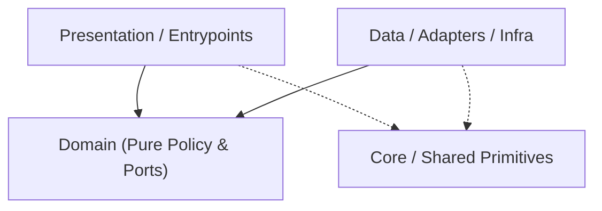

# Codebase Architecture Map — `switchfin`

> Auto-generated by `project-pro map` (2026-11-08 08:40 UTC). Read this first to save exploration tokens.
- **Detected Stack**: `cpp-switch` | **Mode**: `configured`

## 1. Canonical Layer Dependency Flow

## 2. Layer Distribution (Code Files)
- **Domain**: `7` | **Data/Infra**: `3` | **Presentation/UI**: `1` | **Core/Shared**: `0` | **Tests**: `0` | **Other**: `159`

## 3. Module / Directory Index (Top Slices)
- `app/include/activity/` — `5` files (`184` LOC)
- `app/include/api/` — `7` files (`848` LOC)
- `app/include/client/` — `5` files (`129` LOC)
- `app/include/data/` — `2` files (`78` LOC)
- `app/include/domain/` — `7` files (`272` LOC)
- `app/include/presentation/` — `1` files (`48` LOC)
- `app/include/tab/` — `23` files (`831` LOC)
- `app/include/utils/` — `13` files (`749` LOC)
- `app/include/view/` — `27` files (`2047` LOC)
- `app/src/` — `1` files (`145` LOC)
- `app/src/activity/` — `6` files (`964` LOC)
- `app/src/api/` — `3` files (`535` LOC)
- `app/src/client/` — `5` files (`319` LOC)
- `app/src/data/` — `1` files (`290` LOC)
- `app/src/tab/` — `23` files (`5452` LOC)
- `app/src/utils/` — `13` files (`3087` LOC)
- `app/src/view/` — `27` files (`7189` LOC)
- `scripts/forwarder/source/` — `1` files (`479` LOC)
